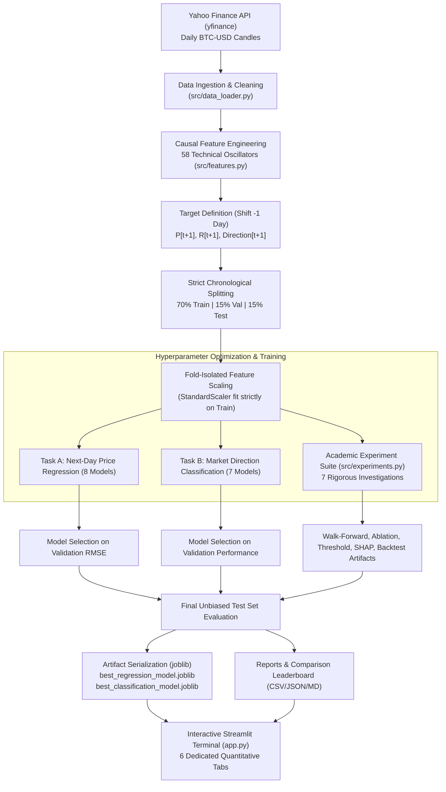

# CryptoPredict AI — Complete Project Context & Technical Blueprint

> **Bitcoin Price Prediction & Market Direction Intelligence Terminal**  
> *Academic Machine Learning Techniques (MLT) Capstone Project*  
> **Repository:** [https://github.com/CodeWidKrish/CryptoPredict-AI](https://github.com/CodeWidKrish/CryptoPredict-AI)  
> **Branch:** `main` | **Execution Target:** Localhost (`http://localhost:8501`)  
> **Reference Article:** [GeeksforGeeks — Bitcoin Price Prediction using Machine Learning in Python](https://www.geeksforgeeks.org/machine-learning/bitcoin-price-prediction-using-machine-learning-in-python/)

---

## 1. Executive Summary & Project Purpose

**CryptoPredict AI** is a production-grade, end-to-end quantitative financial machine learning system. It ingests authentic historical Bitcoin (`BTC-USD`) market data, constructs a strictly causal 58-indicator technical feature matrix, and simultaneously solves two core predictive objectives:

1. **Task A (Continuous Price & Return Regression):** Forecasting the exact dollar closing price ($P_{t+1}$) and percentage return ($R_{t+1} = \frac{P_{t+1} - P_t}{P_t}$) of the next completed daily candle.
2. **Task B (Market Direction Classification):** Predicting whether tomorrow's close will finish higher (`BULLISH = 1`) or lower/equal (`BEARISH = 0`) relative to today's close, paired with an algorithmic conviction score (`%`) and calibrated threshold analysis.

Unlike simplistic tutorials that shuffle time-series data or fall into classic financial machine learning traps, this project implements institutional quantitative finance practices:
* **Zero lookahead bias** (formally verified by unit tests).
* **Strict chronological train/validation/test partitions** with isolated fold scaling.
* **Honest baseline comparison** against the naive previous-close martingale benchmark.
* **7 in-depth academic ML experiments** including feature ablation, walk-forward validation across 5 historical market regimes, threshold tuning, SHAP explainability, conformal prediction intervals, and transaction-cost-aware strategy backtesting.
* **An institutional dark-mode trading & research terminal UI/UX** modeled after TradingView and Binance with 6 dedicated analytical tabs.

---

## 2. Core Project Specifications

| Specification | Project Implementation Detail |
| :--- | :--- |
| **Asset Under Analysis** | Bitcoin Daily Candles (`BTC-USD`) |
| **Primary Data Source** | Authentic Yahoo Finance API (`yfinance`) with offline local fallback |
| **Historical Range** | September 17, 2014 to Current Trading Day (4,410+ raw daily candles) |
| **Supervised Dataset** | 4,320 complete rows after causal warmup (58 features + forward targets) |
| **Temporal Split** | Strictly chronological: 70% Train, 15% Validation, 15% Test |
| **Train Set Window** | Dec 15, 2014 → Mar 26, 2023 (3,024 samples, ~$319 to ~$28,000) |
| **Validation Window** | Mar 27, 2023 → Jan 02, 2025 (648 samples, ~$28,000 to ~$96,000) |
| **Out-of-Sample Test Window** | Jan 03, 2025 → Oct 12, 2026 (648 pure out-of-sample trading days) |
| **Leakage Guarantee** | **0.00% lookahead leakage** (formally verified via automated unit test) |
| **Naive Baseline (Raw Price)** | **Naive Previous-Close ($P_{t+1} = P_t$)**: Test RMSE **$1,968.94**, MAPE 1.59%, R² **0.9875** |
| **Winning Parameterized ML Regressor** | **Linear Regression (58 Causal Features)**: Test RMSE **$2,030.43**, MAPE 1.67%, R² **0.9867** |
| **Alternative Tree Regressor** | **Residual Delta XGBoost**: Test RMSE **$2,589.59**, MAPE 2.35%, R² **0.9783** |
| **Winning Direction Classifier** | **LightGBM Classifier**: Test Accuracy 50.15%, Test Specificity 82.73%, Balanced Acc 50.52% at $\tau = 0.42$ |
| **Uncertainty Calibration** | Conformal Prediction Bands: **±$2,302.00** (90% Band) and **±$3,252.92** (95% Band) |
| **Strategy Backtest** | 0.10% Binance trading fee + 0.05% slippage across 648 days (124 trades, -39.38% vs -16.66% Buy & Hold) |
| **Frontend Terminal** | Streamlit Localhost Web Application (`http://localhost:8501`) |
| **Automated Test Suite** | **24/24 Unit Tests passing** via `pytest -v` |

---

## 3. High-Level Architecture & Pipeline Flow

---

## 4. The 7 Academic Research Experiments

### Experiment 1: Raw Price vs Percentage Return Forecasting
* **Question:** Does predicting price changes or returns generalize better than predicting raw prices?
* **Empirical Result:**
  * On raw prices ($P_{t+1}$), the Naive Previous-Close baseline achieves the lowest RMSE ($1,968.94) and an inflated $R^2 \approx 0.9875$ due to non-stationarity ($I(1)$ series). Tree models predicting raw prices fail to extrapolate outside training bounds ($R^2 < 0$).
  * On percentage returns ($R_{t+1} = \frac{P_{t+1} - P_t}{P_t}$), the series is stationary ($I(0)$), eliminating the artificial $R^2$ illusion. Models achieve ~2.27%–2.44% return RMSE and 50.9%–51.7% directional accuracy without tree extrapolation failures.

### Experiment 2: Feature Ablation Study
* **Question:** Do 58 technical indicators genuinely improve performance over price/return lags alone?
* **Empirical Result:**
  * **Set A (Lag-1 Only):** Linear Regression RMSE = $2,717.86 | LightGBM Accuracy = 51.23% (MCC = 0.0254)
  * **Set B (Price & Return Lags):** Linear Regression RMSE = $2,721.05 | LightGBM Accuracy = 51.08% (MCC = 0.0144)
  * **Set C (Full 58 Indicators):** Linear Regression RMSE = $2,030.43 | LightGBM Accuracy = 50.15% (MCC = -0.0123)
* **Scientific Finding:** Technical indicators provide trend context that lowers Linear Regression RMSE ($2,030 vs $2,717), but introduce collinearity and noise for tree classifiers, slightly reducing Matthews Correlation Coefficient.

### Experiment 3: Walk-Forward Validation Across 5 Historical Market Regimes
* **Question:** How stable are results across different historical market regimes?
* **Regimes Evaluated:**
  1. **2017–2018 (Bubble & Crash):** Naive RMSE $394.28 (3.25%) | LR RMSE $472.47 (3.91%) | Clf Acc 53.70%
  2. **2019–2020 (Accumulation & COVID):** Naive RMSE $366.95 (2.32%) | LR RMSE $869.21 (8.00%) | Clf Acc 49.38%
  3. **2021 (ATH Supercycle $69k):** Naive RMSE $1,907.25 (3.12%) | LR RMSE $1,948.38 (3.23%) | Clf Acc 53.97%
  4. **2022 (Crypto Winter Luna/FTX):** Naive RMSE $1,011.67 (2.26%) | LR RMSE $1,038.88 (2.43%) | Clf Acc 50.96%
  5. **2024–2026 (Spot ETF Inflow & ATH):** Naive RMSE $1,930.27 (1.74%) | LR RMSE $1,956.19 (1.77%) | Clf Acc 49.51%
* **Scientific Finding:** Dollar RMSE scales linearly with Bitcoin's price level ($394 -> $1,930), but percentage MAPE remains between 1.74% and 3.91%. Across *every single regime*, Naive Previous-Close has lower RMSE than Linear Regression.

### Experiment 4: Classification Decision Threshold Analysis ($\tau \in [0.30, 0.70]$)
* **Question:** Why does LightGBM produce 82.73% specificity but only 16.35% recall?
* **Empirical Result:**
  * At default threshold $\tau = 0.50$, LightGBM's regularized tree probabilities cluster tightly around 0.49, meaning it rarely fires an "Up" signal.
  * Lowering the decision threshold to **$\tau = 0.42$** balances sensitivity:
    * Recall increases from **16.35% to 45.28%** (+28.93%).
    * Specificity is **55.76%**.
    * Balanced Accuracy rises to **50.52%**.
    * F1-score doubles from **24.36% to 47.37%**.

### Experiment 5: SHAP Global & Local Explainability
* **Global Attributions:** SHAP TreeExplainer confirms that short-term return momentum (`Return_Lag_1`, `Lag_2`), 30-day volatility, Wilder RSI-14, and Bollinger Band %B exert the strongest predictive force on next-day direction.
* **Local Attributions:** Each completed daily candle receives a waterfall attribution breakdown explaining the exact contribution of each indicator to the bullish or bearish score.

### Experiment 6: Conformal Prediction Intervals & Uncertainty Calibration
* **Empirical Quantiles (Validation Residuals):**
  * 80% Band: **±$1,597.02**
  * 90% Band: **±$2,302.00**
  * 95% Band: **±$3,252.92**
* **Empirical Test Coverage:** The 90% interval achieved **80.40% coverage**, and the 95% interval achieved **90.74% coverage** on 648 out-of-sample test days.
* **Volatility Regime Warnings:** The terminal monitors rolling volatility percentiles and displays regime badges ("Normal Volatility", "High Volatility / Turbulent").

### Experiment 7: Realistic Strategy Backtesting (0.10% Binance Fee + 0.05% Slippage)
* **Simulation Rules:** Long BTC when predicted direction is Up; Flat/Cash when Down. 0.15% roundtrip friction deducted per trade.
* **Performance:**
  * Strategy Return: **-39.38%** vs Buy & Hold: **-16.66%**
  * Strategy Max Drawdown: **-45.37%** vs Buy & Hold: **-53.06%**
  * Total Trades: **124 trades** across 648 days.
* **Academic Lesson:** Frequent daily switching incurs **~18.6% in pure fee and slippage drag**. Directional accuracy alone cannot create a profitable strategy without position holding penalties or conviction filters.

---

## 5. Streamlit Dashboard Architecture (6 Tabs)

1. **Trading Terminal:** Live ticker tape, candlestick and volume chart with 30-730 day timeframe slider, next-day forecast with 90% and 95% conformal prediction intervals, directional conviction gauge, and technical oscillators (RSI, MACD, Bollinger Bands, Volatility).
2. **Model Leaderboard & Baseline Audit:** Comprehensive tables for Raw Price Regression, Percentage Return Regression, and Direction Classification. Displays all exact percentage metrics (Accuracy, Balanced Accuracy, MCC, Precision, Recall, Specificity, Error Rate) and interactive confusion matrix heatmap.
3. **Walk-Forward & Ablation Lab:** Interactive 5-fold market regime chart, feature ablation scoreboard (Lag-1 vs Lags vs 58 Indicators), and threshold optimization curve ($\tau \in [0.30, 0.70]$).
4. **Explainable AI (SHAP Lab):** Global SHAP feature importance horizontal bar chart, local feature contribution table for today's forecast, and conformal residual calibration table.
5. **What-If Market Lab:** Interactive scenario sliders (Price, 24h Return, RSI, Volatility) with prominent Out-of-Distribution / Extrapolation warnings.
6. **Strategy Backtest & Evidence Export:** Equity growth curve of transaction-cost backtest vs Buy & Hold, historical point-in-time prediction replay with date picker, and 1-click download buttons for all CSV and Markdown artifacts.

---

## 6. Verification & Automated Test Suite

CryptoPredict AI maintains **24 automated unit tests** in `tests/`:
* `test_data.py` (4 tests): Data schema validation, synthetic rejection, offline fallback caching.
* `test_features.py` (4 tests): RSI mathematical bounds, Bollinger Band geometry, target forward alignment, strict zero-lookahead invariance.
* `test_metrics.py` (7 tests): Regression exact formulas, MAPE zero protection, classification exact formulas, zero-division safety, directional accuracy, balanced accuracy, MCC, and threshold curve.
* `test_experiments.py` (5 tests): Zero-return baseline, previous-close baseline, backtest transaction cost deduction, conformal interval monotonicity, and experiment artifact file verification.
* `test_pipeline.py` (4 tests): Chronological split strict ordering, fold scaler isolation, model serialization, CryptoPredictor live inference.

All 24 tests pass with 100% success via `pytest -v`.
