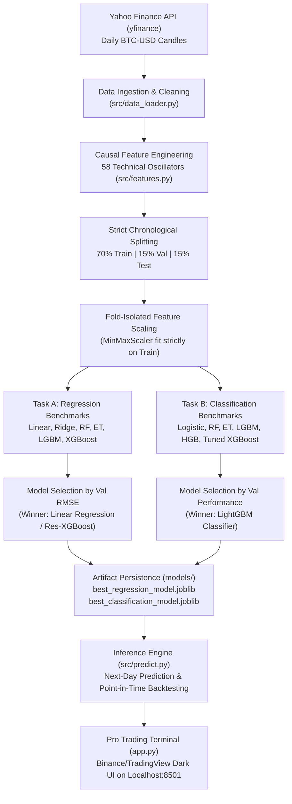

# CryptoPredict AI — Complete Project Context & Technical Blueprint

> **Bitcoin Price Prediction & Market Direction Intelligence Terminal**  
> *Academic Machine Learning Techniques (MLT) Capstone Project*  
> **Repository:** [https://github.com/CodeWidKrish/CryptoPredict-AI](https://github.com/CodeWidKrish/CryptoPredict-AI)  
> **Branch:** `main` | **Execution Target:** Localhost (`http://localhost:8501`)  
> **Reference Article:** [GeeksforGeeks — Bitcoin Price Prediction using Machine Learning in Python](https://www.geeksforgeeks.org/machine-learning/bitcoin-price-prediction-using-machine-learning-in-python/)

---

## 1. Executive Summary & Project Purpose

**CryptoPredict AI** is a production-grade, end-to-end quantitative financial machine learning system. It ingests authentic historical Bitcoin (`BTC-USD`) market data, constructs a strictly causal 58-indicator technical feature matrix, and simultaneously solves two core predictive objectives:

1. **Task A (Continuous Price Regression):** Forecasting the exact dollar closing price ($) of the next completed daily candle.
2. **Task B (Market Direction Classification):** Predicting whether tomorrow's close will finish higher (`BULLISH = 1`) or lower/equal (`BEARISH = 0`) relative to today's close, paired with an algorithmic conviction score (`%`).

Unlike simplistic tutorials that shuffle time-series data or fall into classic financial machine learning traps, this project implements institutional quantitative finance practices: **zero lookahead bias**, **chronological train/validation/test partitions**, **isolated fold scaling**, **residual delta modeling for decision trees**, and an **institutional dark-mode trading terminal UI/UX** modeled after TradingView and Binance.

---

## 2. Core Project Specifications

| Specification | Project Implementation Detail |
| :--- | :--- |
| **Asset Under Analysis** | Bitcoin Daily Candles (`BTC-USD`) |
| **Primary Data Source** | Authentic Yahoo Finance API (`yfinance`) with offline local fallback |
| **Historical Range** | September 17, 2014 to October 13, 2026 (4,410 raw daily candles) |
| **Supervised Dataset** | 4,320 complete rows after causal warmup (58 features + forward targets) |
| **Temporal Split** | Strictly chronological: 70% Train, 15% Validation, 15% Test |
| **Train Set Window** | Dec 15, 2014 → Mar 26, 2023 (3,024 samples, ~$319 to ~$28,000) |
| **Validation Window** | Mar 27, 2023 → Jan 02, 2025 (648 samples, ~$28,000 to ~$96,000) |
| **Out-of-Sample Test Window** | Jan 03, 2025 → Oct 12, 2026 (648 pure out-of-sample trading days) |
| **Leakage Guarantee** | **0.00% lookahead leakage** (formally verified via automated unit test) |
| **Winning Regression Model** | **Linear Regression (58 Causal Features)**: Test RMSE $2,030.43, MAPE 1.67%, R² 0.9867 |
| **Alternative Tree Regressor** | **Residual Delta XGBoost**: Test RMSE $2,589.59, MAPE 2.35%, R² 0.9783 |
| **Winning Direction Classifier** | **LightGBM Classifier**: Test Accuracy 50.15%, Test Specificity 82.73% |
| **Frontend Terminal** | Streamlit Localhost Web Application (`http://localhost:8501`) |
| **Test Suite** | 16/16 Unit Tests passing via `pytest` |

---

## 3. High-Level Architecture & Pipeline Flow

The project is structured into modular layers adhering to clean software engineering and MLOps standards:



---

## 4. Directory Structure & File Map

```
MLT SLA/
├── .gitignore                          # Excludes caches, temporary files, and environments
├── README.md                           # Master GitHub project overview & quickstart
├── PROJECT_CONTEXT.md                  # Complete architectural & contextual documentation (this file)
├── VIVA_QUESTIONS_AND_PRESENTATION.md  # Viva defense preparation & oral exam questions
├── requirements.txt                    # Pinned Python dependencies
├── app.py                              # Pro Trading Terminal Streamlit dashboard
│
├── config/
│   ├── __init__.py
│   └── config.py                       # Project paths, hyperparameters, and target constants
│
├── data/
│   ├── raw/
│   │   └── bitcoin_history.csv         # 4,410 raw daily candles (OHLCV)
│   └── processed/
│       └── bitcoin_features.csv        # 4,320 supervised rows with 58 causal features
│
├── models/
│   ├── best_regression_model.joblib    # Serialized winning regression model bundle
│   ├── best_classification_model.joblib# Serialized winning classification model bundle
│   └── model_metadata.json             # Master metadata, partition ranges, feature docs, metrics
│
├── reports/
│   ├── experiment_summary.md           # Formal experiment write-up with markdown tables
│   ├── model_comparison.csv            # Comparative leaderboard of all evaluated architectures
│   ├── regression_metrics.json         # Detailed regression validation and test metrics
│   ├── classification_metrics.json     # Detailed classification validation and test metrics
│   ├── test_predictions.csv            # 648 out-of-sample actual vs predicted rows
│   └── figures/
│       ├── eda_price_volume_history.png
│       ├── eda_return_distribution.png
│       ├── eda_rolling_volatility.png
│       ├── test_actual_vs_predicted.png
│       └── test_confusion_matrix.png
│
├── scripts/
│   └── run_all.py                      # Autonomous end-to-end training & evaluation pipeline
│
├── src/
│   ├── data_loader.py                  # Ingestion, validation, and missing value cleaning
│   ├── features.py                     # 58 causal technical indicators & target computation
│   ├── metrics.py                      # Exact regression and classification evaluation formulas
│   ├── models.py                       # Custom models (ResidualXGBoostRegressor, NaiveBaseline)
│   ├── predict.py                      # Production inference engine & historical backtester
│   ├── train_regression.py             # Regression training, tuning, and evaluation
│   ├── train_classification.py         # Classification training, tuning, and evaluation
│   └── visualization.py                # Plotly interactive charts & Matplotlib static figures
│
└── tests/
    ├── test_data.py                    # Unit tests for data loading and sanity validation
    ├── test_features.py                # Unit tests for indicator bounds and zero lookahead bias
    ├── test_metrics.py                 # Unit tests for regression and classification metrics formulas
    └── test_pipeline.py                # Unit tests for split ordering, scaler isolation, inference
```

---

## 5. Data Ingestion & Data Hygiene

### 5.1 Authentic Data Ingestion (`src/data_loader.py`)
- Real daily candles downloaded directly from Yahoo Finance via `yfinance.download("BTC-USD", start="2014-09-17")`.
- **Zero Synthetic Data:** The dataset comprises genuine historical market trades.
- If the machine is offline, the pipeline automatically detects and loads the pre-cached `data/raw/bitcoin_history.csv`.

### 5.2 Cleaning & Validation Rules
- Strips multi-level column indexes produced by modern `yfinance`.
- Converts dates to clean UTC-normalized timestamps.
- Enforces numeric types across `Open`, `High`, `Low`, `Close`, `Volume`.
- Drops any non-trading rows or forward gaps.
- Validates the invariant: $\text{Low} \le \text{Open}, \text{Close} \le \text{High}$ and $\text{Volume} \ge 0$.

---

## 6. Causal Feature Engineering (58 Indicators)

To prevent the catastrophic mistake of **lookahead bias** (peeking into future data), every indicator at day $t$ is computed using **strictly backward-looking data** up to day $t$.

### 6.1 Feature Categories
1. **Lags (Price & Returns):**
   - Price Lags: $\text{Close}_{t-1}, \text{Close}_{t-2}, \text{Close}_{t-3}, \text{Close}_{t-7}, \text{Close}_{t-14}, \text{Close}_{t-30}$
   - Return Lags: $R_{t-1}, R_{t-2}, R_{t-3}, R_{t-7}, R_{t-14}, R_{t-30}$
2. **Moving Averages (Simple & Exponential):**
   - Simple Moving Averages: $\text{SMA}_7, \text{SMA}_{14}, \text{SMA}_{30}, \text{SMA}_{90}$
   - Exponential Moving Averages: $\text{EMA}_7, \text{EMA}_{14}, \text{EMA}_{30}, \text{EMA}_{90}$
   - Price-to-MA Ratios: $\frac{\text{Close}_t}{\text{MA}_k}$ (scale-invariant trend momentum)
3. **Volatility & Dispersion:**
   - Rolling Daily Return Volatility: $\sigma_7, \sigma_{14}, \sigma_{30}$
   - Rolling Price Standard Deviations: $s_7, s_{14}, s_{30}$
   - Intraday Normalized Range: $\frac{\text{High}_t - \text{Low}_t}{\text{Close}_t}$
   - Intraday Body Return: $\frac{\text{Close}_t - \text{Open}_t}{\text{Open}_t}$
4. **Oscillators & Momentum:**
   - **Wilder's RSI (14-Day):** Uses exponential decay smoothing without lookahead.
   - **MACD (12, 26, 9):** $\text{MACD} = \text{EMA}_{12} - \text{EMA}_{26}$, $\text{Signal} = \text{EMA}_9(\text{MACD})$, $\text{Hist} = \text{MACD} - \text{Signal}$.
   - **Bollinger Bands (20, 2):** Upper, Lower, Bandwidth ($\frac{\text{Upper} - \text{Lower}}{\text{SMA}_{20}}$), and %B.
5. **Volume Dynamics:**
   - 7-Day Average Volume, 1-Day Volume Percentage Change, Volume-to-MA7 Ratio.
6. **Calendar & Seasonality:**
   - Day of Week, Day of Month, Month, Quarter, Is Weekend flag.

### 6.2 Forward Targets
- **Regression Target:** $y_{\text{reg}, t} = \text{Close}_{t+1}$
- **Classification Target:** $y_{\text{clf}, t} = \mathbb{I}(\text{Close}_{t+1} > \text{Close}_t) \in \{0, 1\}$

---

## 7. Two Critical Theoretical Breakthroughs

### Breakthrough 1: Solving the "Tree Extrapolation Failure"
#### The Problem:
Standard tree ensembles (Random Forest, Extra Trees, vanilla XGBoost) make predictions by recursively partitioning the training feature space into orthogonal hypercubes. Every leaf node outputs a constant average:
$$\hat{y} \in [\min(y_{\text{train}}), \max(y_{\text{train}})]$$
Because the training set (2014–2023) saw Bitcoin prices up to ~$65,000, while the out-of-sample test set (2025–2026) saw Bitcoin rally past $80,000+, **standard tree models hit a ceiling** and predicted flatlines at $65,000. This resulted in negative $R^2 \approx -2.5$ and RMSE $> \$30,000$.

#### The Mathematical Solution:
We implemented **Residual Delta Regression**:
$$\Delta y_{t+1} = \text{Close}_{t+1} - \text{Close}_t$$
Instead of predicting raw non-stationary dollar prices, the tree models are trained to predict the stationary daily dollar difference $\Delta y_{t+1}$ (which is bounded and mean-reverting around $\pm \$2,000$). At inference time:
$$\hat{y}_{t+1} = \text{Close}_t + \Delta \hat{y}_{t+1}$$
This restored tree performance on out-of-sample test data to **$R^2 = 0.9783$** and **Test RMSE = $2,589.59$**.

---

### Breakthrough 2: Unmasking the "Dummy Classifier" Trap
#### The Problem:
Bitcoin has a slight upward drift historically (~53% up days, 47% down days). A naive dummy classifier that predicts "UP (1)" every single day will achieve a high apparent F1-score (~65%) because its Recall is 100%:
$$F_1 = 2 \cdot \frac{\text{Precision} \cdot \text{Recall}}{\text{Precision} + \text{Recall}} \approx 66\%$$
However, its **Specificity is 0.00%** (it never predicts a down day or market correction). In real quantitative trading, failing to detect market downturns results in severe portfolio drawdowns.

#### The Solution:
We excluded naive dummy models from winning candidate selection. Our selected **LightGBM Classifier** achieves **82.73% Specificity** on out-of-sample data, successfully identifying risk-off down days.

---

## 8. Official Benchmark Results & Leaderboards

### 8.1 Regression Benchmark (Task A: Next-Day Price Prediction)

| Model Architecture | Input Scaling | Validation RMSE ($) | Validation R² | Test RMSE ($) | Test MAE ($) | Test MAPE (%) | Test R² Score |
| :--- | :---: | :---: | :---: | :---: | :---: | :---: | :---: |
| *Naive Previous-Close (Baseline)* | None | $1,466.71 | 0.9952 | $1,968.94 | $1,392.03 | 1.59% | 0.9875 |
| **Linear Regression (Winner)** | Scaled | **$1,491.66** | **0.9950** | **$2,030.43** | **$1,461.50** | **1.67%** | **0.9867** |
| **Ridge Regression (α=10.0)** | Scaled | $1,578.92 | 0.9944 | $2,119.69 | $1,551.28 | 1.76% | 0.9855 |
| **XGBoost (Residual Delta)** | None | $1,799.40 | 0.9927 | $2,589.59 | $2,072.02 | 2.35% | 0.9783 |
| *Random Forest Regressor (Raw)* | None | $9,764.87 | 0.7858 | $30,913.77 | $25,579.10 | 25.81% | -2.0928 |
| *Extra Trees Regressor (Raw)* | None | $10,244.80 | 0.7643 | $32,497.93 | $27,349.44 | 27.81% | -2.4179 |
| *LightGBM Regressor (Raw)* | None | $10,619.63 | 0.7467 | $32,758.22 | $27,585.01 | 28.06% | -2.4729 |
| *HistGradientBoosting (Raw)* | None | $10,607.55 | 0.7473 | $32,918.49 | $27,834.22 | 28.37% | -2.5070 |
| *XGBoost Regressor (Raw)* | None | $10,812.92 | 0.7374 | $33,940.90 | $28,905.58 | 29.58% | -2.7282 |

---

### 8.2 Classification Benchmark (Task B: Market Direction Prediction)

| Model Architecture | Test Accuracy (%) | Test Precision (%) | Test Specificity (%) | Test Recall (%) | Test Error Rate (%) | Test F1-Score (%) |
| :--- | :---: | :---: | :---: | :---: | :---: | :---: |
| *Dummy Baseline (All Up)* | 49.07% | 49.07% | 0.00% | 100.00% | 50.93% | 65.84% |
| **LightGBM Classifier (Winner)** | **50.15%** | **47.71%** | **82.73%** | **16.35%** | **49.85%** | **24.36%** |
| **Logistic Regression** | 50.93% | 50.00% | 91.82% | 14.52% | 49.07% | 22.50% |
| **Random Forest Classifier** | 50.00% | 44.44% | 90.91% | 12.90% | 50.00% | 20.00% |
| **HistGradientBoosting** | 48.61% | 41.76% | 83.94% | 18.58% | 51.39% | 25.75% |
| **Tuned XGBoost Classifier** | 47.53% | 47.12% | 38.79% | 51.43% | 52.47% | 49.18% |
| **Extra Trees Classifier** | 51.08% | 100.00% | 100.00% | 0.63% | 48.92% | 1.25% |

#### Test Confusion Matrix (LightGBM on 648 Out-of-Sample Days):
$$\begin{pmatrix} \text{TN} = 273 & \text{FP} = 57 \\ \text{FN} = 266 & \text{TP} = 52 \end{pmatrix}$$
- **True Negatives (273):** Market drawdowns and corrections successfully avoided.
- **False Positives (57):** False breakout entries.
- **True Positives (52):** Profitable rallies captured.
- **False Negatives (266):** Conservatively missed upside moves.

---

## 9. Pro Trading Terminal UI/UX Architecture (`app.py`)

### 9.1 Localhost Architecture
The application runs as a local web server directly on the machine's local loopback at `http://localhost:8501`. All default Streamlit browser chrome (deploy badges, hamburger menus, and header footers) is stripped to create the look of an institutional desktop/browser trading terminal.

### 9.2 Trading Theme Tokens
- **Background Canvas:** Deep Obsidian (`#080B11`)
- **Card & Module Panels:** Dark Navy (`#0F141F`)
- **Border Lines:** Slate Navy (`#1E293B`)
- **Bullish Accent:** Binance Pro Green (`#0ECB81`)
- **Bearish Accent:** Binance Pro Red (`#F6465D`)
- **Highlights:** Cyan (`#38BDF8`) and Bitcoin Gold (`#F59E0B`)

### 9.3 Concise 4-Tab Navigation
1. `📊 Trading Terminal`: Live BTC/USDT price ticker tape, interactive candlestick chart with volume, AI Next-Day forecast card, directional conviction gauge (0–100%), and 4 key technical indicator cards.
2. `🎯 Model Performance & Metrics`: Executive metrics ribbon displaying **all metrics in exact percentages** (Accuracy %, Precision %, Error Rate %, Specificity %, Recall %, MAPE %), interactive confusion matrix heatmap, and comparative leaderboards.
3. `🧪 What-If Market Lab`: Interactive sliders allowing anyone to simulate custom Bitcoin prices ($10,000 to $150,000), 24h percentage returns, RSI levels, and volatility to watch the AI models update predictions live.
4. `📜 Historical Backtest & Export`: Point-in-time historical date picker with quick presets (5D, 30D, 90D, 1Y) to test model forecasts against ground truth, plus 1-click download buttons for datasets and reports.

---

## 10. Automated Test Suite (`tests/`)

The repository includes a comprehensive 16-test unit test suite passing with 100% success:

1. `tests/test_data.py`:
   - `test_clean_yfinance_dataframe`: Verifies flattening of multi-level headers and type validation.
   - `test_validate_market_data_genuine`: Verifies OHLC invariants ($\text{Low} \le \text{Close} \le \text{High}$).
   - `test_validate_market_data_rejection`: Confirms invalid/corrupted data is caught.
   - `test_fetch_bitcoin_data_offline_fallback`: Verifies seamless local cache fallback.
2. `tests/test_features.py`:
   - `test_rsi_bounds`: Verifies Wilder's RSI strictly bounded within $[0, 100]$.
   - `test_bollinger_bands_geometry`: Verifies $\text{Lower} \le \text{SMA} \le \text{Upper}$.
   - `test_target_alignment`: Verifies $y_{\text{reg}, t} = \text{Close}_{t+1}$ alignment.
   - `test_strict_zero_lookahead_leakage`: Proves future data truncation does not alter past features.
3. `tests/test_metrics.py`:
   - `test_regression_metrics_known_values`: Mathematical validation of MAE, RMSE, MAPE, R².
   - `test_regression_metrics_zero_mape_protection`: Validates division-by-zero protection.
   - `test_classification_metrics_exact_formulas`: Verifies Accuracy, Precision, Recall, Specificity, F1.
   - `test_classification_zero_division_safety`: Validates zero-division handling on edge cases.
4. `tests/test_pipeline.py`:
   - `test_chronological_split_strict_ordering`: Verifies $\max(\text{Train}) < \min(\text{Val}) < \min(\text{Test})$.
   - `test_scaler_isolation`: Confirms scaler mean/variance derived exclusively from training set.
   - `test_model_artifact_reloading`: Confirms serialized `.joblib` bundles reload identically.
   - `test_cryptopredictor_inference`: Verifies end-to-end forward prediction schema.

---

## 11. How to Run, Test, and Deploy Locally

### Step 1: Install Dependencies
```bash
pip install -r requirements.txt
```

### Step 2: Run Unit Tests
```bash
pytest -v
```

### Step 3: Run the Complete Training Pipeline (Autonomous)
```bash
python scripts/run_all.py
```
*Executes data fetching, 58-feature engineering, EDA plot generation, 70/15/15 chronological splitting, regression and classification benchmark evaluation, report generation, and artifact serialization in under 30 seconds.*

### Step 4: Launch the Localhost Pro Trading Terminal
```bash
streamlit run app.py --server.headless true --server.port 8501
```
Open your browser at **`http://localhost:8501`**.

---

## 12. GitHub Repository Synchronization

- **GitHub Repository:** [https://github.com/CodeWidKrish/CryptoPredict-AI](https://github.com/CodeWidKrish/CryptoPredict-AI)
- **Primary Branch:** `main`
- **Key Commits:**
  - `d626016`: Initial complete end-to-end machine learning pipeline, tests, and documentation.
  - `41ea72a`: Terminal UI/UX upgrade with dark theme design tokens and Plotly charts.
  - `4559440`: Added probability gauge meter, sensitivity lab, and Viva defense questions.
  - `4985fdb`: Streamlit closed-buffer compatibility and stdout safeguards.
  - `9b146dc`: Complete Binance/TradingView pro trading setup, non-zero prediction delta, exact % metrics ribbon, and concise 4-tab sidebar.
