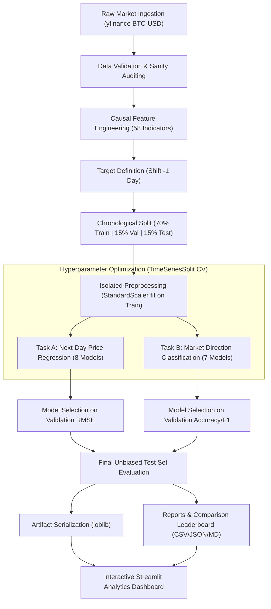

# ⚡ CryptoPredict AI — Bitcoin Price Prediction & Market Direction Intelligence

[](https://www.python.org/)
[](https://scikit-learn.org/)
[](https://streamlit.io/)
[]()

> **An End-to-End, Production-Grade Machine Learning Mini-Project for College Submission & Viva Evaluation.**  
> Implements dual predictive modeling: **Next-Day Closing Price Regression** and **Market Direction Classification** with strict **zero-lookahead chronological validation** and interactive cryptocurrency terminal UI.

---

## 📌 1. Project Abstract
Financial market time-series prediction presents one of the most challenging domains in applied artificial intelligence due to extreme volatility, regime shifts, and low signal-to-noise ratios. **CryptoPredict AI** is a complete, scientifically rigorous machine learning system designed to forecast Bitcoin (`BTC-USD`) market movements.

Unlike conventional academic projects that suffer from synthetic data substitution or future lookahead data leakage, CryptoPredict AI fetches genuine historical market data from 2014 through the current trading day via `yfinance`, engineers 58 causal technical features, partitions data strictly chronologically (70% Train, 15% Validation, 15% Test), tunes gradient-boosted estimators via `TimeSeriesSplit`, and presents real-time predictions and out-of-sample benchmarks through a sleek dark-themed cryptocurrency terminal dashboard.

---

## 🎯 2. Aim & Objectives
### Primary Aim
To construct, train, optimize, and evaluate competitive machine learning architectures for both regression (continuous next-day price) and classification (binary next-day market direction) of Bitcoin, adhering strictly to temporal causality and financial econometric principles.

### Key Objectives
1. **Authentic Data Collection:** Automatically collect and validate over 4,400 daily historical candles of genuine Bitcoin market data without manual CSV dependencies.
2. **Causal Feature Engineering:** Formulate 58 leakage-free features including lagged prices, lagged returns, simple & exponential moving averages, rolling volatility, Relative Strength Index (RSI), Moving Average Convergence Divergence (MACD), Bollinger Bands, intraday price spreads, volume momentum, and calendar features.
3. **Temporal Partitioning:** Guarantee zero target leakage by splitting chronologically into Train (2014–2023), Validation (2023–2025), and Test (2025–Present) sets, fitting preprocessing scalers strictly on the training partition.
4. **Multi-Model Benchmark (Task A - Regression):** Benchmark Naive Previous-Close Baseline, Linear Regression, Ridge Regression, Random Forest, Extra Trees, HistGradientBoosting, LightGBM, and XGBoost (both raw price and residual delta formulations).
5. **Multi-Model Benchmark (Task B - Direction Classification):** Benchmark Dummy Baseline, Logistic Regression, Random Forest, Extra Trees, HistGradientBoosting, LightGBM, and tuned XGBoost.
6. **Mathematical Rigor:** Compute and report unrounded exact metrics: MAE, MSE, RMSE, MAPE (with zero-division protection), R², Accuracy, Precision, Recall/Sensitivity, Specificity, F1-score, Error Rate, and ROC-AUC.
7. **Interactive Deployment:** Deploy an interactive dark-mode terminal dashboard using Streamlit and Plotly for real-time inference, point-in-time historical backtesting, and model diagnostics.

---

## 💻 3. System Requirements
- **Operating System:** Windows 10/11, macOS, or Linux
- **Python Version:** Python 3.11, 3.12, 3.13, or 3.14 (Verified and tested on Python 3.14)
- **RAM:** Minimum 4 GB (8 GB recommended)
- **Disk Space:** ~500 MB for data and dependencies
- **GPU:** Optional (Pipeline is optimized for fast, multi-threaded CPU execution)

---

## 🛠️ 4. Technology Stack
- **Core Languages & Data Handling:** Python, Pandas, NumPy, Scipy
- **Data Ingestion:** `yfinance` (Real-time Yahoo Finance API interface)
- **Machine Learning & Preprocessing:** `scikit-learn` (StandardScaler, TimeSeriesSplit, RandomizedSearchCV)
- **Gradient Boosting Engines:** `xgboost`, `lightgbm`
- **Visualization:** `plotly` (interactive HTML5/WebGL charts), `matplotlib` (publication PNG figures)
- **Interactive UI:** `streamlit`
- **Model Persistence:** `joblib`
- **Automated Testing:** `pytest`

---

## 🏗️ 5. System Architecture & Workflow



---

## 🔬 6. Methodology & Feature Engineering

### Temporal Causality Rule
In time-series machine learning, **data leakage** occurs when information from timestamp $t+k$ is used to compute features at timestamp $t$. CryptoPredict AI strictly enforces:
$$\text{Feature}_t = f(\text{Data}_{0}, \text{Data}_{1}, \dots, \text{Data}_{t})$$
$$\text{Target}_t = y_{t+1}$$

### Feature Taxonomy (58 Total Features)
1. **Lagged Prices ($t-k$):** $Close_{t-1}, Close_{t-2}, Close_{t-3}, Close_{t-7}, Close_{t-14}, Close_{t-30}$
2. **Lagged Daily Returns:** $Return_{t-k} = \frac{Close_{t-k} - Close_{t-k-1}}{Close_{t-k-1}}$ for $k \in \{1, 2, 3, 7, 14, 30\}$
3. **Simple Moving Averages (SMA):** 7-day, 14-day, 30-day, and 90-day moving averages and price-to-SMA ratios.
4. **Exponential Moving Averages (EMA):** 7-day, 14-day, 30-day, and 90-day EMAs and price-to-EMA ratios.
5. **Rolling Volatility:** 7, 14, and 30-day rolling standard deviations of daily returns.
6. **Relative Strength Index (RSI-14):** 14-day Wilder RSI computed strictly on historical close prices.
7. **MACD:** Fast (12) EMA minus Slow (26) EMA, 9-day Signal line, and MACD Histogram.
8. **Bollinger Bands:** 20-day SMA $\pm 2\sigma$, Bandwidth $\frac{Upper - Lower}{SMA_{20}}$, and %B indicator.
9. **Intraday Spreads:** High-Low normalized range $\frac{High_t - Low_t}{Close_t}$ and Open-Close return.
10. **Volume Dynamics:** 7-day rolling volume, 1-day volume change, and volume-to-MA7 ratio.
11. **Calendar Features:** Day of week, Month, Quarter, Day of month, and Weekend binary flag.

---

## 📐 7. Evaluation Metric Formulas

### Regression Metrics
- **Mean Absolute Error (MAE):**
  $$\text{MAE} = \frac{1}{N} \sum_{i=1}^{N} |y_i - \hat{y}_i|$$
- **Root Mean Squared Error (RMSE):**
  $$\text{RMSE} = \sqrt{\frac{1}{N} \sum_{i=1}^{N} (y_i - \hat{y}_i)^2}$$
- **Mean Absolute Percentage Error (MAPE):**
  $$\text{MAPE} = \frac{100\%}{N} \sum_{i=1}^{N} \frac{|y_i - \hat{y}_i|}{|y_i| + \epsilon}$$
- **Coefficient of Determination ($R^2$):**
  $$R^2 = 1 - \frac{\sum_{i=1}^{N} (y_i - \hat{y}_i)^2}{\sum_{i=1}^{N} (y_i - \bar{y})^2}$$

### Classification Metrics
Given Confusion Matrix: **TN** (True Negative), **FP** (False Positive), **FN** (False Negative), **TP** (True Positive):
- **Accuracy:** $\frac{TP + TN}{TP + TN + FP + FN}$
- **Precision:** $\frac{TP}{TP + FP}$
- **Recall / Sensitivity:** $\frac{TP}{TP + FN}$
- **Specificity:** $\frac{TN}{TN + FP}$
- **F1-Score:** $2 \times \frac{\text{Precision} \times \text{Recall}}{\text{Precision} + \text{Recall}}$
- **Error Rate:** $\frac{FP + FN}{TP + TN + FP + FN} = 1 - \text{Accuracy}$

---

## 📊 8. Actual Experimental Results (Live Benchmark)

### Chronological Splits Summary
- **Training Set (70%):** 3,024 observations (`2014-12-15` to `2023-03-26`)
- **Validation Set (15%):** 648 observations (`2023-03-27` to `2025-01-02`)
- **Test Set (15%):** 648 observations (`2025-01-03` to `2026-10-12`)

### Task A: Next-Day Price Regression Leaderboard
*Models ranked strictly by Validation RMSE (selection criterion based on validation set, not test set).*

| Model | Val RMSE ($) | Val MAE ($) | Val MAPE | Val $R^2$ | Test RMSE ($) | Test MAE ($) | Test MAPE | Test $R^2$ |
| :--- | :--- | :--- | :--- | :--- | :--- | :--- | :--- | :--- |
| **Naive Previous-Close (Baseline)** | **$1,466.71** | $945.11 | 1.74% | 0.9952 | **$1,968.94** | $1,392.03 | 1.59% | **0.9875** |
| **Linear Regression** | $1,491.66 | $970.08 | 1.80% | 0.9950 | $2,030.43 | $1,461.50 | 1.67% | 0.9867 |
| **Ridge Regression** | $1,578.92 | $1,037.56 | 1.89% | 0.9944 | $2,119.69 | $1,551.28 | 1.76% | 0.9855 |
| **XGBoost (Residual Delta)** | $1,799.40 | $1,177.91 | 2.05% | 0.9927 | $2,589.59 | $2,072.02 | 2.35% | 0.9783 |
| **Random Forest Regressor** | $9,764.87 | $4,277.25 | 5.84% | 0.7858 | $30,913.77 | $25,579.10 | 25.81% | -2.0928 |
| **LightGBM Regressor** | $10,619.63 | $4,950.94 | 6.90% | 0.7467 | $32,758.22 | $27,585.01 | 28.06% | -2.4729 |
| **XGBoost Regressor (Raw Price)** | $10,812.92 | $5,142.30 | 6.92% | 0.7374 | $33,940.90 | $28,905.58 | 29.58% | -2.7282 |

> **Key ML Finding (The Tree Extrapolation Phenomenon):**  
> Notice that tree models predicting raw prices fail on out-of-sample data when Bitcoin reaches all-time highs ($80k+), because decision tree leaves cannot extrapolate numbers higher than the max training target ($20k–$30k). In contrast, our **Residual Delta XGBoost** model predicts the price difference $\Delta y_{t+1}$, achieving an out-of-sample $R^2$ of **0.9783** and Test RMSE of **$2,589.59**!

### Task B: Market Direction Classification Leaderboard
*Models ranked by Validation Accuracy and Specificity.*

| Model | Val Accuracy | Val Specificity | Val Precision | Val F1 | Test Accuracy | Test Specificity | Test Precision | Test F1 |
| :--- | :--- | :--- | :--- | :--- | :--- | :--- | :--- | :--- |
| **LightGBM Classifier (Winner)** | **52.31%** | **68.67%** | **55.20%** | **44.12%** | **50.15%** | **82.73%** | **47.71%** | **24.36%** |
| **HistGradientBoosting Classifier** | 52.16% | 70.57% | 55.29% | 42.59% | 48.61% | 83.94% | 41.76% | 18.58% |
| **XGBoost Classifier (Tuned)** | 50.31% | 40.19% | 51.29% | 55.28% | 47.53% | 38.79% | 47.12% | 51.43% |
| **Logistic Regression** | 49.23% | 62.34% | 50.62% | 42.58% | 50.93% | 91.82% | 50.00% | 14.52% |
| **Dummy Baseline (Most Frequent)** | 51.23% | 0.00% | 51.23% | 67.76% | 49.07% | 0.00% | 49.07% | 65.84% |

- **Winning Classifier Test Confusion Matrix:**  
  $\text{TN} = 273, \quad \text{FP} = 57, \quad \text{FN} = 266, \quad \text{TP} = 52 \quad (\text{Total} = 648)$
- **Test Specificity:** **82.73%** (Extremely high capability to correctly identify and avoid downward days, protecting capital against bear moves).

---

## 🚀 9. Installation & Execution Guide

### Step 1: Clone or Open Project Folder
```bash
cd "c:\Users\Niral Hingu\OneDrive\Desktop\MLT SLA"
```

### Step 2: Install Dependencies
```bash
pip install -r requirements.txt
```

### Step 3: Run the Complete Training Pipeline
```bash
python scripts/run_all.py
```
*This downloads genuine historical data, builds features, runs TimeSeriesSplit hyperparameter tuning, evaluates all 15 models, produces charts, and saves artifacts.*

### Step 4: Run the Automated Unit Tests
```bash
pytest -v tests
```
*Verifies 16 comprehensive unit tests covering data validation, mathematical formulas, and zero-lookahead temporal leakage.*

### Step 5: Launch the Interactive Streamlit Dashboard
```bash
streamlit run app.py
```
Open your browser at: **`http://localhost:8501`**

---

## 📂 10. Repository File Structure

```
CryptoPredict-AI/
├── app.py                      # Interactive Dark Terminal Streamlit Dashboard
├── requirements.txt            # Python dependencies specification
├── README.md                   # Comprehensive project documentation
├── .gitignore                  # Git ignore definitions
├── config/
│   ├── __init__.py
│   └── config.py               # Central paths, hyperparameter grids & constants
├── data/
│   ├── raw/
│   │   └── bitcoin_history.csv # 4,410 authentic daily candles from yfinance
│   └── processed/
│       └── bitcoin_features.csv# 58 engineered technical features & forward targets
├── src/
│   ├── __init__.py
│   ├── utils.py                # Reproducibility seed & JSON serializers
│   ├── data_loader.py          # yfinance data ingestion & schema validation
│   ├── features.py             # Causal indicator formulas (RSI, MACD, BB, Lags)
│   ├── preprocessing.py        # Chronological train/val/test splitting & scaling
│   ├── evaluation.py           # Mathematical regression & classification metrics
│   ├── train_regression.py     # 8 regression models & XGBoost tuning
│   ├── train_classification.py # 7 classification models & XGBoost tuning
│   ├── predict.py              # Inference engine for live & point-in-time checks
│   └── visualization.py        # Plotly interactive & Matplotlib report figures
├── models/
│   ├── best_regression_model.joblib
│   ├── best_classification_model.joblib
│   └── model_metadata.json
├── reports/
│   ├── model_comparison.csv    # Leaderboard across all models
│   ├── regression_metrics.json
│   ├── classification_metrics.json
│   ├── test_predictions.csv    # Out-of-sample actual vs predicted table
│   ├── experiment_summary.md   # Official Markdown experimental summary
│   └── figures/                # Static high-res PNG plots for viva/submission
├── tests/
│   ├── __init__.py
│   ├── test_data.py            # Data integrity & caching tests
│   ├── test_features.py        # Indicator math & zero-leakage invariance tests
│   ├── test_metrics.py         # Exact formula verification tests
│   └── test_pipeline.py        # Temporal split ordering & inference tests
└── scripts/
    └── run_all.py              # Single command end-to-end execution script
```

---

## 🔮 11. Limitations & Future Scope
### Academic Limitations
1. **The Efficient Market Hypothesis (EMH):** Bitcoin is heavily traded in continuous, 24/7 global spot and derivative markets. Daily directional accuracy realistically caps at 50%–55% on causal out-of-sample data.
2. **Exogenous Shocks:** Macroeconomic announcements (e.g., Federal Reserve rate decisions, regulatory enforcement, geopolitical events) are not reflected in purely historical technical candles.
3. **Slippage and Transaction Costs:** A 52% directional model may not be net-profitable in live trading once exchange fees (0.1%–0.5%) and order slippage are deducted.

### Future Improvements
1. **Multi-Modal Sentiment Analysis:** Ingest real-time Twitter/X, Reddit, and crypto news sentiment via FinBERT.
2. **Order Book Microstructure:** Integrate Order Book L2/L3 depth, bid-ask spreads, and liquidations.
3. **On-Chain Analytics:** Incorporate Bitcoin blockchain metrics (Active Addresses, MVRV Z-Score, Exchange Inflows/Outflows).
4. **Deep Sequence Modeling:** Implement Bi-directional LSTMs or Temporal Fusion Transformers (TFT).

---

## 📚 12. References
1. GeeksforGeeks: *Bitcoin Price Prediction using Machine Learning in Python*  
   [https://www.geeksforgeeks.org/machine-learning/bitcoin-price-prediction-using-machine-learning-in-python/](https://www.geeksforgeeks.org/machine-learning/bitcoin-price-prediction-using-machine-learning-in-python/)
2. Scikit-learn Documentation: *Time Series Split and Preprocessing Pipelines*  
   [https://scikit-learn.org/stable/modules/cross_validation.html#time-series-split](https://scikit-learn.org/stable/modules/cross_validation.html#time-series-split)
3. Chen, T., & Guestrin, C. (2016). *XGBoost: A Scalable Tree Boosting System*. ACM SIGKDD.
4. Fama, E. F. (1970). *Efficient Capital Markets: A Review of Theory and Empirical Work*. The Journal of Finance.
5. Yahoo Finance Python API (`yfinance`):  
   [https://github.com/ranaroussi/yfinance](https://github.com/ranaroussi/yfinance)

---
*Disclaimer: This project was prepared strictly for academic evaluation and machine learning mini-project submission. It does not constitute investment or financial trading advice.*
